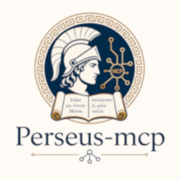

Perseus MCP
===========

.. container:: api-intro

   Python tools for discovering, searching, and reading Greek and Latin texts.

Reference for |docs_version|, package version |release|.
Explore the API, or choose a tagged release from the version selector.

.. container:: api-links

   :doc:`Modules and compatibility <architecture>`
   How the server is organized and how existing notebook integrations work.

   :doc:`Functions and tools <modules>`
   Signatures, parameters, and behavior for every module and MCP tool.

.. toctree::
   :maxdepth: 2
   :hidden:
   :caption: Reference

   architecture
   modules

* :ref:`genindex`
* :ref:`modindex`

